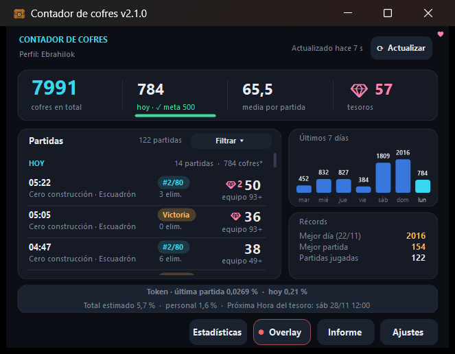
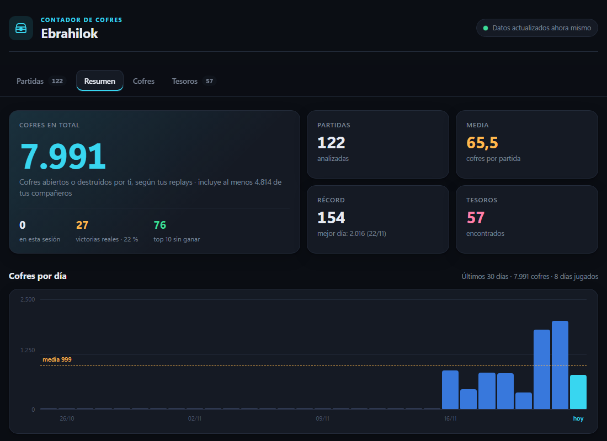
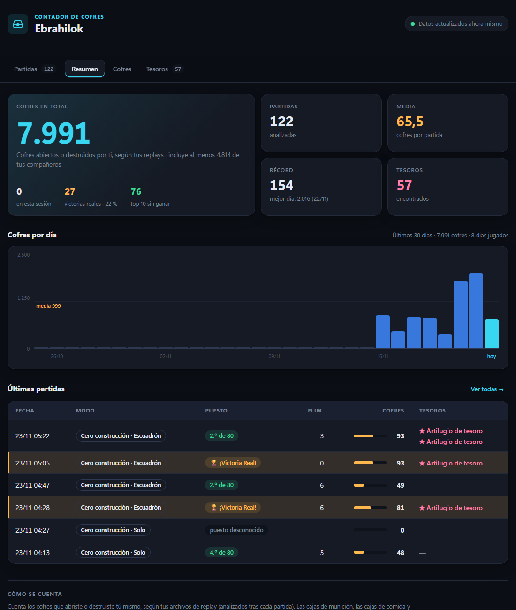
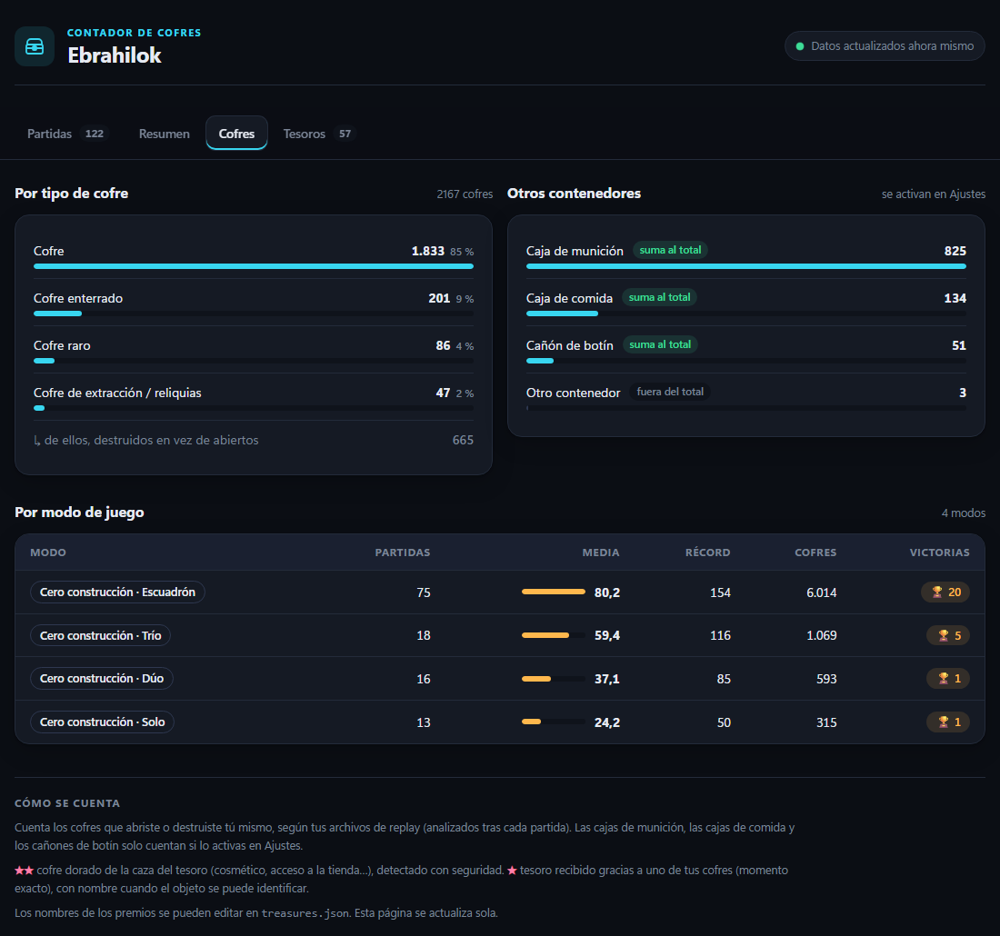
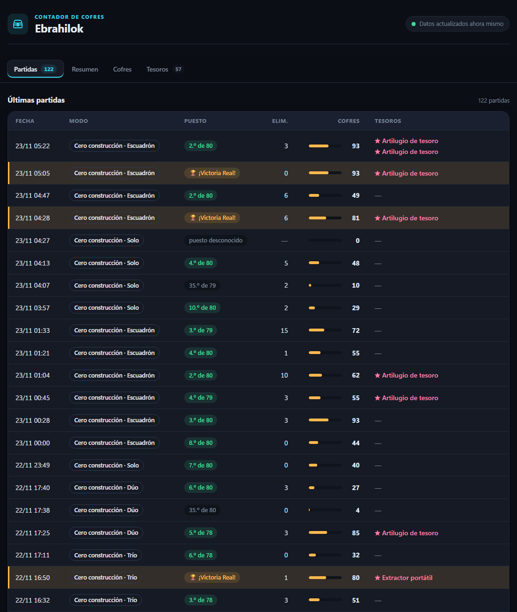
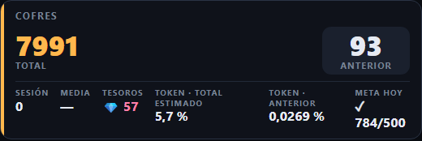
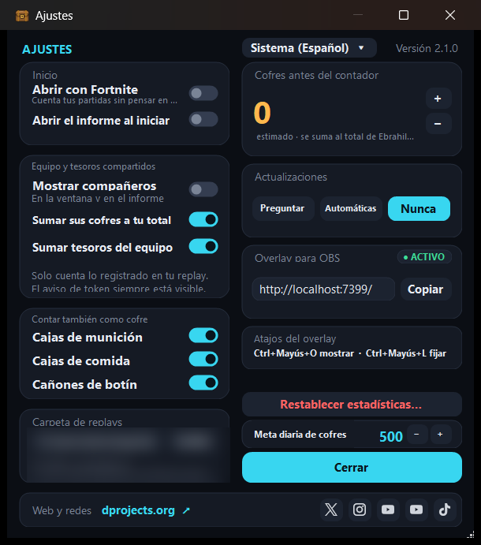

<div align="center">

[Español](README.md) · **English**

# Fortnite Chest Counter

[](../../releases/latest) [](../../releases)  [](LICENSE)

**Counts every chest you open in Fortnite, match after match: window, report, in-game overlay and your team's chests.**

&nbsp;

[**⬇ Download the latest version**](../../releases/latest) · Windows 10 / 11 · free · no install · 10 languages

</div>

---

> [!NOTE]
> **This is a fork.** The original project is [**xdoofy92/ChestCounter**](https://github.com/xdoofy92/ChestCounter), by **Doofy**: replay parsing, the overlay, treasures and almost everything else is their work. This fork, by [**Ebrahilok**](https://github.com/Ebrahilok), mainly changes **the interface**.

## Why this fork

I play a lot and the tool counted chests well, but the main window was **confusing**: more than ten figures with the same weight, some data repeated (the last match showed twice; total, session and today got mixed up), and what I cared about most, **how many chests I opened in each match and who opened what**, wasn't visible in the app: you had to open the report in the browser. There was also no way to know when it last updated or to force it. And with Windows **Smart App Control** on, the exe couldn't be opened at all.

What changes compared to the original:

- **The match list is the center of the window**: newest first (the one you're playing, in green), with when, mode, placement, eliminations and your chests in large type. **All** saved matches are shown.
- **Click a match → details inside the app**: your chests by type, the ones you broke, ammo and food boxes, **what each teammate opened** and the treasures with who got them. The HTML report only opens with its button.
- **List grouped by day** ("Today · 6 matches · 381 chests") and **filters** by mode, wins / top 10 or teammate; with a filter on, the summary is recalculated.
- **Timeline** in each match's details: when you opened each chest, by what minute you had half of them, your busiest minute and the treasures.
- **Statistics** inside the app: your chest luck (treasure and **pirate token** odds worked out from your own chests), chests by placement, by mode and with each teammate.
- **Pirate token odds for each match**: at 1 in 137,500 per chest (×1.5 during Treasure Hour, chest by chest), in the overlay ("Token odds", current or previous match), in the window's strip (last match and today), in each match's details and in Stats (what was expected from all your chests versus what you got). The rate comes from the community, not Epic: change it in `TokenOdds.cs`.
- **Daily chest goal** (in Settings): a bar under "today", a column in the overlay and a notice when you reach it. It also tells you when you **beat your record** for chests in one match.
- **⟳ Refresh button** (looks for new matches right away) and **"Updated X ago"**.
- **Summary down to four figures**: total, today, average and treasures. Records and team go in the right column.
- **"≥ 36" becomes "36+"**, explained: it's a minimum because your replay only has what happens near you.
- **Report**: opens on **Matches**, shows the whole history (it used to be the latest 100) and says how long ago the data was updated.
- The 7-day chart no longer cuts 4-digit figures (2016 read as "201").
- **Folder version (zip)** for Smart App Control users: the single-file exe is unsigned and Smart App Control blocks it with no way to open it.
- Automatic updates come from **this** repository, not the original.
- All new text is translated into the app's 10 languages.

ChestCounter reads the replays Fortnite saves of every match and keeps count of the chests you open, the **treasure hunt treasures** and, if you want, your **teammates'** chests. Everything is saved on your PC: even when Fortnite deletes the replays, your history is kept.

- **Main window**: your list of matches with each one's chests and, on click, who opened what.
- **Report** in your browser, with tabs: overview, chests, treasures, matches and teammates.
- **Overlay** on top of the game and an **OBS page**.
- **Teammates**: who you play with, wins together, each one's chests per match and a leaderboard.
- **Safe**: it only reads replay files; it never touches the game or its memory.

> It counts the chests **you** opened (and those your team was seen opening). It does not show where chests are on the map.

## Getting started

1. Download **[`ChestCounter.exe`](../../releases/latest)**. That single file is all you need.
   > **Smart App Control** won't let you open it? Download **`ChestCounter-carpeta.zip`** from the same release, unzip it and open the `ChestCounter.exe` inside (needs the [.NET 10 desktop runtime](https://dotnet.microsoft.com/download/dotnet/10.0)). That version doesn't update itself: download the new zip when a version comes out.
2. In Fortnite turn on *Settings → Game → Replays → **Record Replays*** (and *Large Team Modes* if you play them). Without replays there is nothing to read.
3. Run `ChestCounter.exe`.
   > Windows may show *"Windows protected your PC"* because the exe is not signed. Click *More info → Run anyway*.
4. The welcome screen reminds you about replays and, if there are already replays on your PC, lets you **count them** or start with **your next matches only**.

<p align="center"></p>

5. Leave the window open (you can minimize it) while you play. During the match the counter reads the replay being recorded and adds the chests **live**; when the match ends they are confirmed.

> [!TIP]
> Matches played while the counter is closed are counted next time you open it, as long as Fortnite has not deleted those replays (it keeps a limited number). To not think about it, turn on **Open with Fortnite** in Settings.

## The main window

<p align="center"></p>

- **Header**: your profile (or a picker, with several accounts on the PC), **"Updated X ago"** and the **⟳ Refresh** button, which looks for new matches right away. While you play it says *Match in progress*.
- **Summary**: chests in total, today, average per match and treasures.
- **Matches** (the center): all your matches, grouped by day and newest first. The **Filter** button shows only one mode, wins / top 10, or the matches with a teammate (press it again to clear the filter). Each row: when, mode, placement (gold = win, cyan = top 10), eliminations, treasures (💎) and your chests in large type. With *Teammates* on, the team total goes underneath ("team 72+"). Scroll with the mouse wheel.
- **Click a match**: its details open inside the app: your chests by type, destroyed ones, other containers, **what each teammate opened** (by type) and the treasures with who got them.
- **Last 7 days**: a chart with each day's chests.
- **Records** (or **Team**, with *Teammates* on): best day, best match and matches played; or your chests and each teammate's in the current or last match.
- **Treasure Hours** (better treasure odds): the bottom strip shows when the next one is, in your local time. On a day with one, a countdown appears next to the profile; during the hour, the window, the overlay and the OBS page turn gold and the title counts down the time left.
- **Stats**: treasure and pirate token odds from your chests (Epic doesn't publish the figures: it's an estimate from your data; with no token yet, it gives an upper bound), chests by placement (more chests = better placement?), by mode and with each teammate (click one to see your matches together).
- **Daily goal**: set it in Settings; it shows as a bar under "today" and in the overlay, with a notice when you reach it. Beating your record for chests in one match also shows a notice.
- **Buttons**: **Stats**, **Overlay** (green dot = on), **Report** and **Settings**.
- **♥** (top right): a thank-you message, with the creator code **DOOFY**.

The window can be resized and maximized: everything grows in proportion.

## The report

`report.html` opens in your browser (the **Report** button) and refreshes by itself. It starts on **Matches**, and the top right says how long ago the data was updated. These are the tabs:

| Tab | What it shows |
|---|---|
| **Matches** | Every saved match: mode, placement (🏆 win, top 10 in green), eliminations, chests, treasures and, with teammates, the team. |
| **Overview** | Chest total, session, Victory Royales (and %), top 10s, matches, average, best match, best day, treasures, 30-day chart and the latest matches. |
| **Chests** | By chest type, other containers (ammo boxes, food boxes, loot cannons; shows whether they count) and a **by game mode** table. |
| **Treasures** | How many, from golden chests, with a certain source, % of matches with a treasure, where they come from and the list with the exact moment. |
| **Teammates** | Team chests, **top teammates**, the **per match** table and all your teammates (see below). |

<p align="center"></p>

<details>
<summary><b>See the other tabs</b></summary>

<p align="center"></p>
<p align="center"></p>
<p align="center"></p>
<p align="center"></p>

</details>

It uses the window's colors (dark, or light when Windows is in light mode) and adapts to phones. The screenshots are in Spanish; the report follows the app's language.

## Teammates and team

Turn it on in **Settings → Teammates in the report** (off by default). You get:

- **Exact**: who you play with, matches together and wins together.
- **Approximate**: each teammate's chests. They come from **your** replay, and only include openings Fortnite sent to the recorder. There is no guaranteed maximum radius: they are a **minimum**, shown with **+** ("13+" = at least 13).
- **Team chests**: you + your teammates, in total and per match, with each one's share; handy when you hunt for a random item that drops from chests.
- **Top teammates**: most chests seen, best average, best single match and most wins together.

### How your teammates' chests are worked out

1. **A replay is not a video**: it's a recording of the data the Fortnite server sent to **your** game during the match.
2. **Every chest is an object with a state**: one field says whether it's been opened (`bAlreadySearched`) and another **which player opened it** (`SearchingPawn`). If someone breaks it instead, the server also says who broke it.
3. **The counter walks through the replay** and, each time a chest becomes opened, checks who did it: you, or a teammate. **Nothing is guessed from proximity**: the data comes from the server.
4. **The limit**: the server only sends your game what happens **near you** (Unreal Engine's *network relevancy*). If a teammate opens a chest far away, that never reaches your replay and can't be counted. That's why their figures are a **minimum** ("13+"). Yours are always exact.

**How close do they need to be?** Epic doesn't publish the radius. In an analysis of 100 replays (see [`docs/analisis-replays-2026-11-12.md`](docs/analisis-replays-2026-11-12.md), in Spanish), the original author measured the distance between both players at each teammate opening:

- Teammate openings were recorded up to **about 597 m** away (examples: 597, 406, 364, 348 and 327 m).
- That is **not a guaranteed limit**: it hasn't been shown that everything below that distance gets recorded, nor that nothing farther does.
- In practice: **if you stick together**, a teammate's number is almost exact; **if you split up**, it falls short (a "0+" usually means they were far away, not that they opened nothing).
- The counter applies **no distance cutoff**: it counts everything in the replay.

To get a teammate's exact figures, they'd have to run the counter with **their own** replays.

With **Add their chests to your total** (also off), your total, average, records and overlay include your team's chests. Your history does not change: turning it off shows only yours again.

## The overlay

<p align="center">&nbsp;&nbsp;</p>

- **Big numbers**: your chest **total** and, in the box, the **previous** match (or the **current** one, live, while you play).
- **Session**, session **average**, **previous** (during a match) and **treasures**.

To see it over the game, set Fortnite to **Windowed Fullscreen** (*Settings → Video → Window Mode*): in exclusive fullscreen Windows cannot draw on top. The overlay starts **off**: turn it on with the **Overlay** button or Ctrl+Shift+O.

Streaming? While the counter is open, the same overlay is at **http://localhost:7373/** (copy it from **Settings**). In OBS, add a **browser source** with that address: transparent background, refreshes by itself.

### Shortcuts

| Shortcut | What it does |
|---|---|
| **Ctrl+Shift+O** | Show / hide the overlay. Works anywhere, even in game. |
| **Ctrl+Shift+L** | Lock / unlock the overlay. **Locked**: clicks go through and it does not move. **Unlocked**: drag it with the left button. |
| Right-click on the overlay | Hide it. |

## Settings

<p align="center"></p>

- **Language**: the Windows language by default; at the top you can pick another (Spanish, English, Portuguese, Russian, French, German, Italian, Polish, Turkish or Japanese).
- **Open with Fortnite**: a small invisible process opens the counter (minimized) when Fortnite starts and closes it 30 s after Fortnite closes. It reads nothing from the game: it only looks at the list of running programs.
- **Open the report at startup** (off by default).
- **Teammates in the report** and **Add their chests to your total** (see above).
- **Also count as a chest**: ammo boxes, food boxes and loot cannons (off; nothing is deleted when you change it). Chests you **destroy** are always counted.
- **Chests before the counter**: an estimate added to your total.
- **Updates**, **overlay for OBS**, **replays folder** and **Reset statistics** (with a backup).

## How it works (and why it is safe)

Fortnite can record a **replay file** of every match on your PC. ChestCounter reads those files and nothing else.

- ✅ **Only reads replay files**: the `.replay` files in `%LOCALAPPDATA%\FortniteGame\Saved\Demos`, read-only.
- ✅ **No game modification**: the Fortnite installation folder is never touched.
- ✅ **No access to the game's memory**: it never reads, writes or injects anything into the Fortnite process.
- ✅ **No data sent anywhere**: no login, no Epic account, no telemetry. The only network access is checking GitHub for new versions (can be turned off).
- ✅ **Lightweight**: low priority ("efficiency mode" on Windows 11) and it sleeps between matches.

## Treasures

- **★★ Golden chest (certain).** When a chest gives a treasure hunt prize (cosmetic, music track, vehicle…), the server spawns a golden chest carrying the **prize id**, which the tool reads from the replay.
- **★ Every treasure received (exact moment)**, with the chest it came from; it only counts if that chest is **yours**. When the item cannot be identified it shows as **"Treasure gizmo"**.
- A treasure obtained from something other than a chest (loot cannon, ammo box…) is flagged with ⚑.

The game only sends prize ids: `treasures.json` names them and can be edited with Notepad.

## Profiles (several accounts on one PC)

There is no name to type: the player who recorded each replay is counted. With replays from several accounts, each one gets its profile and a **drop-down** at the top right picks which one is shown.

## Updates

At startup, the counter checks GitHub (**this** repository) for a new version and, by default, **installs it by itself** between two matches (your history and settings are kept). In Settings you can choose *Ask* or *Never* (no network access). The folder version (zip) doesn't update itself.

## Your data

Everything is saved in `%APPDATA%\ChestCounter`. **Your history does not depend on the replays**: each match (with its chests, treasures and teammates) is saved to `data.json` as soon as it is read, and every statistic comes from there.

| File | Contents |
|---|---|
| `data.json` | Your whole history. **Back it up** if you change PC. |
| `report.html` | The report. |
| `matches.csv` | One line per match, for Excel or Google Sheets. |
| `config.json` | Settings, profile, replays folder and overlay position. |
| `treasures.json` | Names of the treasure hunt prizes. |
| `overlay.html` | Copy of the overlay (for OBS, http://localhost:7373/ is better). |
| `errors.log` | Replays that could not be read, to attach to a bug report. |

## FAQ

**Nothing is counted.** Check that replays are on in Fortnite. The window tells you if the replays folder is missing or empty.

**How does it know who opened each chest?** The replay records what the server sent your game. Each chest carries a field saying whether it's open and **who opened it** (or broke it): nothing is guessed from proximity.

**Why are my teammates' chests low?** The server only sends your game what happens near you, so your replay may omit distant openings (recorded up to almost 600 m, but there's no guaranteed radius). It's a minimum, not their total. Your own chests are exact.

**What if I play more than 100 matches, or Fortnite deletes a replay?** Nothing is lost and your total doesn't go down. Every match is saved in `data.json` as soon as it's read, and all figures come from there, not from the replays. Just open the counter now and then (or turn on *Open with Fortnite*) so it reads the replays before Fortnite deletes them.

**Can I get banned?** The counter doesn't touch the game: it doesn't read its memory, inject anything or modify files. It only reads the replays Fortnite saves to disk, and the overlay is a separate window (like Discord's or OBS's). It gives no advantage. Still, Epic decides: in prize tournaments, the safest choice is to leave the overlay off.

**How do I start over?** **Settings → Reset statistics…** (with confirmation and a `data-backup-….json` backup).

**Creative modes?** Only Battle Royale matches are counted.

**"Cannot read this replay".** A Fortnite update may change the format. Matches already counted are kept. Open an [issue](../../issues) and attach `errors.log`.

**Can a match be counted twice?** No, even if you rename or save the replay.

## Command line options

```
ChestCounter.exe --demos <folder>   another replays folder
ChestCounter.exe --data <folder>    another data folder
ChestCounter.exe --once             analyze the finished replays and quit
ChestCounter.exe --reset-config     run the first-time setup again
ChestCounter.exe --overlay-preview <file.png>   save overlay previews and quit
```

## Building from source

Install the [.NET 10 SDK](https://dotnet.microsoft.com/download/dotnet/10.0) (Windows x64) and double-click **`build.bat`**: the exe goes to `dist\ChestCounter.exe`. GitHub Actions builds the exe and the zip on every push and publishes a release when a `v*` tag is pushed.

With Smart App Control on, build the folder version and open `dist-app\ChestCounter.exe`:

```
dotnet publish src/ChestCounter/ChestCounter.csproj -c Release -r win-x64 --self-contained false -p:PublishSingleFile=false -o dist-app
```

## License and credits

[MIT](LICENSE). Original project: [xdoofy92/ChestCounter](https://github.com/xdoofy92/ChestCounter), by Doofy; this fork keeps its license and credits. Replay parsing is based on [FortniteReplayDecompressor](https://github.com/Shiqan/FortniteReplayDecompressor) by Shiqan (MIT), lightly modified: see [`lib/PATCHES.md`](lib/PATCHES.md).

This project is not affiliated with, endorsed or sponsored by Epic Games. Fortnite is a registered trademark of Epic Games, Inc.

Statistics only include recognized Battle Royale and Zero Build playlists (v43+). Settings can be resized and maximized. **Include team treasures** adds shared team rewards to your treasure totals without changing stored history. The treasure report separates own, team and other observed rewards. The permanent Pirate Shop Token card below the chart and action buttons shows its status even with no detections. Confirmed detections in the current or previous match are highlighted in gold with recipient details; clicking opens Treasures. Settings groups teammate visibility and shared chest/treasure totals under Team and shared treasures. Unknown numeric prize IDs are retained without guessing their identity.
