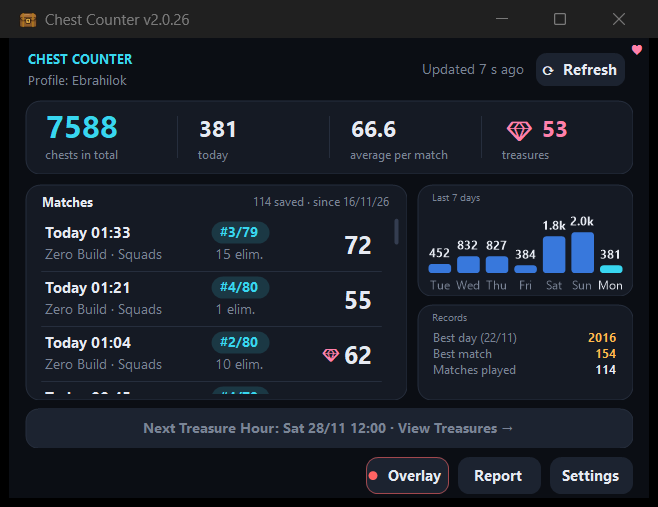
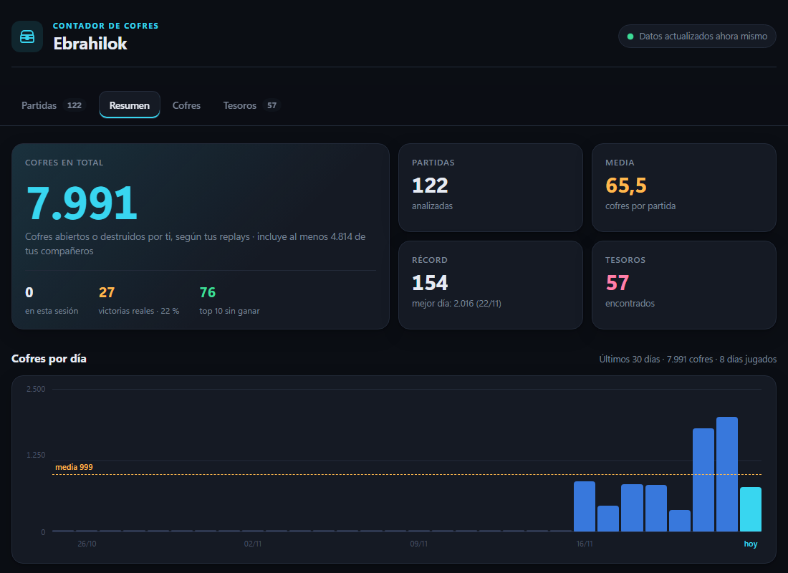
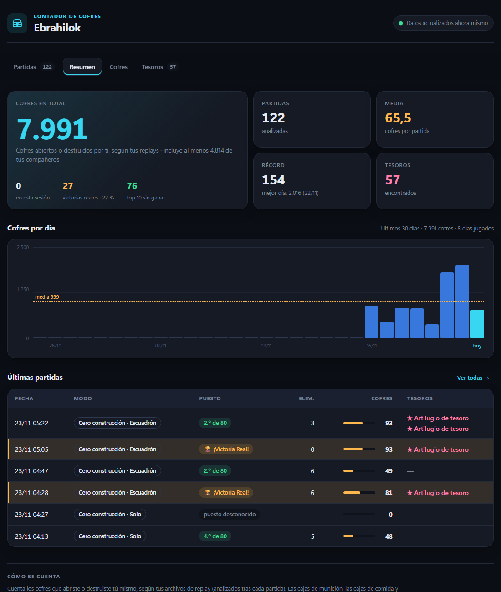
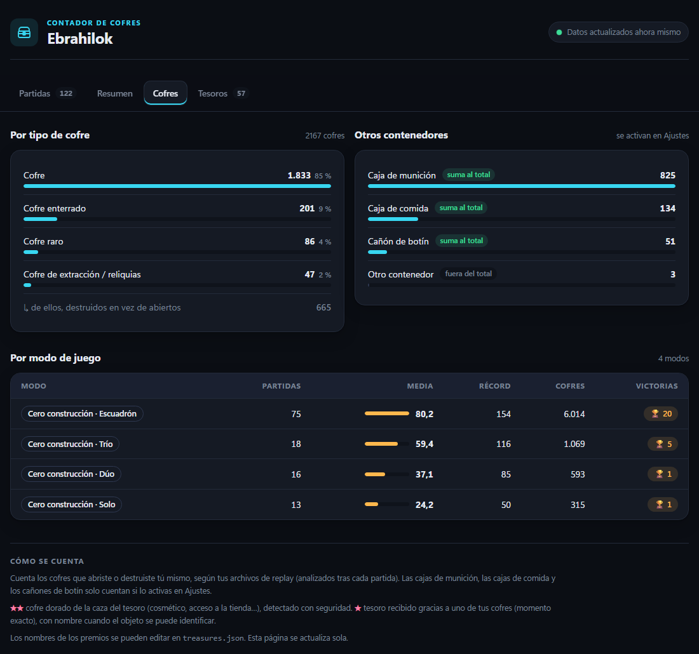
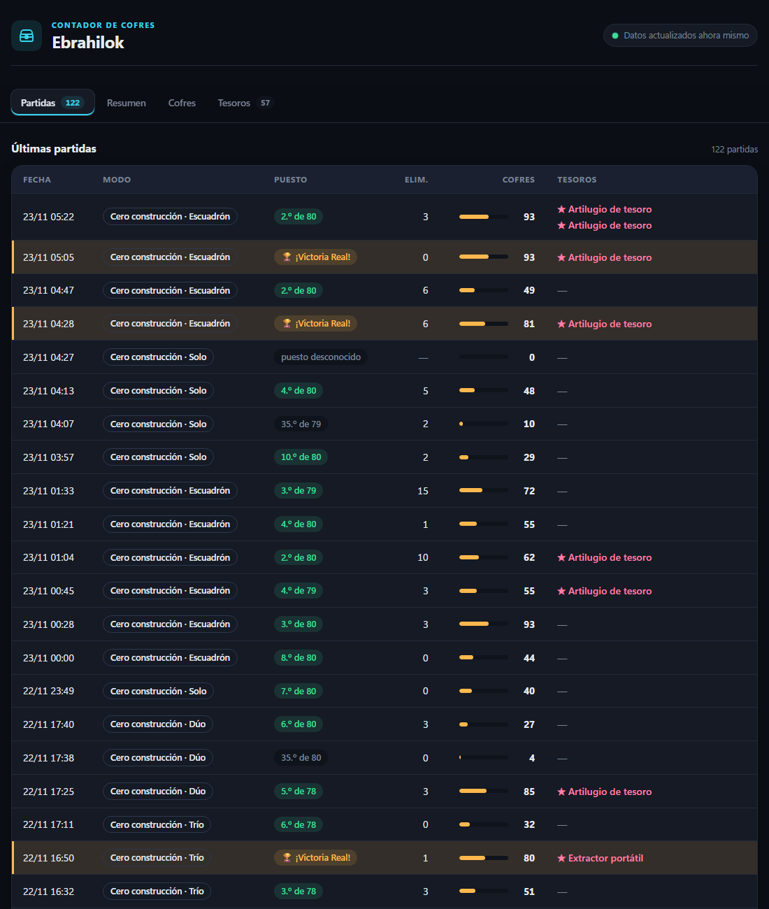
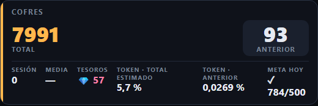
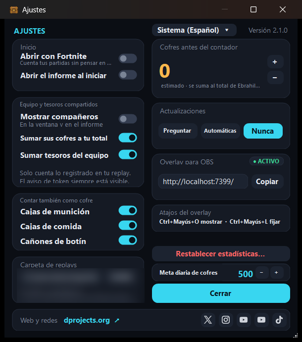

<div align="center">

**Español** · [English](README.en.md)

# Contador de cofres de Fortnite

[](../../releases/latest) [](../../releases)  [](LICENSE)

**Cuenta cada cofre que abres en Fortnite, partida tras partida: ventana, informe, overlay sobre el juego y los cofres de tu equipo.**

&nbsp;

[**⬇ Descargar la última versión**](../../releases/latest) · Windows 10 / 11 · gratis · sin instalación · 10 idiomas

</div>

---

> [!NOTE]
> **Esto es un fork.** El proyecto original es [**xdoofy92/ChestCounter**](https://github.com/xdoofy92/ChestCounter), creado por **Doofy**: el análisis de los replays, el overlay, los tesoros y casi todo lo demás es trabajo suyo. Este fork, de [**Ebrahilok**](https://github.com/Ebrahilok), cambia sobre todo **la interfaz**.

## Por qué este fork

Juego muchas partidas y la herramienta contaba bien los cofres, pero la ventana principal me resultaba **confusa**: había más de diez cifras con el mismo peso, algunos datos salían repetidos (la última partida aparecía dos veces; total, sesión y hoy se mezclaban) y lo que más me interesaba, **cuántos cofres abrí en cada partida y quién abrió qué**, no se veía en la app: había que abrir el informe en el navegador. Tampoco se sabía cuándo se había actualizado por última vez ni había forma de forzarlo. Y con **Smart App Control** de Windows activado, el exe no se podía abrir de ninguna manera.

Qué cambia respecto al original:

- **La lista de partidas es el centro de la ventana**: la más reciente arriba (la que estás jugando, en verde), con cuándo, modo, puesto, eliminaciones y tus cofres en grande. Se ven **todas** las partidas guardadas, no solo las últimas.
- **Clic en una partida → detalle dentro de la app**: tus cofres por tipo (normal, raro, enterrado…), los que rompiste, cajas de munición y comida, **lo que abrió cada compañero** y los tesoros con quién los consiguió. El informe HTML solo se abre con su botón.
- **Botón ⟳ Actualizar** (busca partidas nuevas al momento) y el texto **«Actualizado hace X»**.
- **Resumen con solo cuatro cifras**: total, hoy, media y tesoros. Los récords y el equipo van en la columna derecha.
- **«≥ 36» pasa a «36+»**, explicado: es un mínimo porque tu replay solo tiene lo que pasa cerca de ti.
- **Informe**: abre en **Partidas**, muestra todo el historial (antes las 100 últimas) y dice hace cuánto se actualizaron los datos.
- El gráfico de 7 días ya no corta las cifras de 4 dígitos (2016 se leía «201»).
- **Versión en carpeta (zip)** para quien tiene Smart App Control: el exe de un solo archivo no está firmado y Smart App Control lo bloquea sin opción de abrirlo.
- Las actualizaciones automáticas vienen de **este** repositorio, no del original.

ChestCounter lee las repeticiones (replays) que Fortnite guarda de cada partida y lleva la cuenta de los cofres que abres, de los **tesoros de la caza del tesoro** y, si quieres, de los cofres de tus **compañeros de equipo**. Todo se guarda en tu PC: aunque Fortnite borre los replays, tu historial se conserva.

- **Ventana principal**: la lista de tus partidas con los cofres de cada una y, al hacer clic, quién abrió qué.
- **Informe** en el navegador, con pestañas: resumen, cofres, tesoros, partidas y compañeros.
- **Overlay** sobre el juego y **página para OBS**.
- **Compañeros**: con quién juegas, victorias juntos, cofres de cada uno por partida y un top.
- **Seguro**: solo lee archivos de replay; no toca el juego ni su memoria.

> Cuenta los cofres que **tú** abriste (y los que se vio abrir a tu equipo). No muestra dónde están los cofres en el mapa.

## Primeros pasos

1. Descarga **[`ChestCounter.exe`](../../releases/latest)**. Ese único archivo es todo lo que necesitas.
   > ¿Tienes **Smart App Control** activado y no te deja abrirlo? Descarga **`ChestCounter-carpeta.zip`** del mismo release, descomprímelo y abre el `ChestCounter.exe` de dentro (necesita el [runtime de escritorio de .NET 10](https://dotnet.microsoft.com/download/dotnet/10.0)). Esa versión no se actualiza sola: descarga el zip nuevo cuando salga una versión.
2. En Fortnite activa *Ajustes → Juego → Repeticiones → **Grabar repeticiones*** (y *Modos de equipos grandes* si los juegas). Sin repeticiones no hay nada que leer.
3. Ejecuta `ChestCounter.exe`.
   > Windows puede mostrar *"Windows protegió tu PC"* porque el exe no está firmado. Haz clic en *Más información → Ejecutar de todas formas*.
4. La bienvenida te recuerda lo de las repeticiones y, si ya tienes replays en el PC, te deja **contarlos** o empezar **solo con las próximas partidas**.

<p align="center"></p>

5. Deja la ventana abierta (puedes minimizarla) mientras juegas. Durante la partida el contador lee el replay que se está grabando y suma los cofres **en directo**; al terminar, se confirman.

> [!TIP]
> Las partidas que juegas con el contador cerrado se cuentan la próxima vez que lo abras, mientras Fortnite no haya borrado esos replays (guarda un número limitado). Para no tener que pensar en ello, activa **Abrir con Fortnite** en Ajustes.

## La ventana principal

<p align="center"></p>

- **Cabecera**: tu perfil (o un selector, si hay varias cuentas en el PC), **«Actualizado hace X»** y el botón **⟳ Actualizar**, que busca partidas nuevas al momento. Mientras juegas dice *Partida en curso*.
- **Resumen**: cofres en total, hoy, media por partida y tesoros.
- **Partidas** (el centro): todas tus partidas, la más reciente arriba. Cada fila: cuándo, modo, puesto (dorado = victoria, cian = top 10), eliminaciones, tesoros (💎) y tus cofres en grande. Con *Compañeros* activado, debajo va el total del equipo («equipo 72+»). Se desplaza con la rueda del ratón.
- **Clic en una partida**: se abre su detalle dentro de la app: tus cofres por tipo, los destruidos, otros contenedores, **lo que abrió cada compañero** (por tipo) y los tesoros con quién los consiguió.
- **Últimos 7 días**: un gráfico con los cofres de cada día.
- **Récords** (o **Equipo**, con *Compañeros* activado): mejor día, mejor partida y partidas jugadas; o tus cofres y los de cada compañero en la partida actual o la última.
- **Horas del tesoro** (más probabilidad de tesoros): la franja de abajo dice cuándo es la próxima, en tu hora local. El día que hay una, junto al perfil aparece una cuenta atrás; durante la hora, la ventana, el overlay y la página de OBS se ponen dorados y el título cuenta el tiempo que queda.
- **Botones**: **Overlay** (punto verde = activado), **Informe** y **Ajustes**.
- **♥** (arriba a la derecha): un mensaje de agradecimiento, con el código de creador **DOOFY**.

La ventana se puede redimensionar y maximizar: todo crece en proporción.

Las estadísticas incluyen únicamente las playlists reconocidas de Battle Royale y Cero construcción (v43 o posterior). Ajustes también se puede redimensionar y maximizar.

## El informe

`report.html` se abre en tu navegador (botón **Informe**) y se actualiza solo. Empieza en **Partidas** y arriba a la derecha dice hace cuánto se actualizaron los datos. Estas son las pestañas:

| Pestaña | Qué muestra |
|---|---|
| **Partidas** | Todas las partidas guardadas: modo, puesto (🏆 victoria, top 10 en verde), eliminaciones, cofres, tesoros y, con compañeros, el equipo. |
| **Resumen** | Total de cofres, sesión, victorias (y %), top 10, partidas, media, récord, mejor día, tesoros, gráfico de 30 días y las últimas partidas. |
| **Cofres** | Por tipo de cofre, otros contenedores (cajas de munición, de comida, cañones; indica si suman al total) y una tabla **por modo de juego**. |
| **Tesoros** | Cuántos, de cofres dorados, con origen seguro, % de partidas con tesoro, de dónde vienen y la lista con el momento exacto. |
| **Compañeros** | Cofres del equipo, **top de compañeros**, la tabla **por partida** y todos tus compañeros (ver abajo). |

<p align="center"></p>

<details>
<summary><b>Ver las demás pestañas</b></summary>

<p align="center"></p>
<p align="center"></p>
<p align="center"></p>
<p align="center"></p>

</details>

Usa los colores de la ventana (oscuro, o claro si Windows está en modo claro) y se adapta al móvil.

## Compañeros y equipo

Actívalo en **Ajustes → Compañeros en el informe** (desactivado por defecto). Verás:

- **Exacto**: con quién juegas, partidas juntos y victorias juntos.
- **Aproximado**: los cofres de cada compañero. Salen de **tu** replay, y solo incluyen las aperturas que Fortnite envió al grabador. No hay un radio máximo garantizado: son un **mínimo**, y por eso se muestran con **+** («13+» = al menos 13).
- **Cofres del equipo**: tú + tus compañeros, en total y por partida, con el % que aporta cada uno; útil si buscáis un objeto aleatorio que sale de los cofres.
- **Top de compañeros**: más cofres vistos, mejor media, récord en una partida y más victorias juntos.

Con **Sumar tesoros del equipo** puedes incluir los premios compartidos en tus totales de tesoros. El informe distingue los propios, los del equipo y los de otros jugadores observados; un origen por coincidencia temporal se marca como probable. La tarjeta permanente **Token de Tienda Pirata**, debajo del gráfico y los botones, muestra el estado incluso sin detecciones. Si se identifica uno en la partida actual o anterior, se resalta en dorado e indica quién lo recibió; al pulsarla abre Tesoros. En Ajustes, **Equipo y tesoros compartidos** agrupa mostrar compañeros y sumar sus cofres o tesoros. Los premios de ID numérico desconocido se conservan sin inventar su identidad.

### Cómo se calculan los cofres de tus compañeros

1. **El replay no es un vídeo**: es la grabación de los datos que el servidor de Fortnite envió a **tu** juego durante la partida.
2. **Cada cofre es un objeto con su estado**: un dato dice si ya está abierto (`bAlreadySearched`) y otro **qué jugador lo abrió** (`SearchingPawn`). Si alguien lo rompe en vez de abrirlo, el servidor también dice quién lo rompió.
3. **El contador recorre el replay** y, cada vez que un cofre pasa a abierto, mira quién fue: si eres tú, suma a lo tuyo; si es un compañero de tu equipo, suma a ese compañero. **No se adivina por cercanía**: el dato viene del propio servidor.
4. **El límite**: el servidor solo envía a tu juego lo que pasa **cerca de ti** (lo que Unreal Engine llama *relevancia de red*). Si tu compañero abre un cofre lejos, ese dato nunca llega a tu replay y no se puede contar. Por eso sus cifras son un **mínimo** («13+»). Las tuyas siempre son exactas.

**¿Qué tan cerca tiene que estar?** Epic no publica el radio. En un análisis de 100 replays (ver [`docs/analisis-replays-2026-11-12.md`](docs/analisis-replays-2026-11-12.md)), el autor original midió la distancia entre los dos jugadores en el momento de cada apertura de un compañero:

- Se registraron aperturas de compañeros hasta **unos 597 m** de distancia (ejemplos: 597, 406, 364, 348 y 327 m).
- Eso **no es un límite garantizado**: no se ha demostrado que se registre todo lo que pasa por debajo de esa distancia ni que más lejos no llegue nada.
- En la práctica: **si vais juntos**, el número del compañero es casi exacto; **si os separáis mucho**, se queda corto (un «0+» suele significar que estaba lejos, no que no abriera nada).
- El contador **no aplica ningún corte de distancia**: cuenta todo lo que haya en el replay.

Para tener las cifras exactas de un compañero, él tendría que usar el contador con **sus propios** replays.

Con **Sumar sus cofres a tu total** (también desactivado), tu total, media, récords y overlay incluyen los cofres de tu equipo. Tu historial no cambia: al desactivarlo vuelves a ver solo los tuyos.

## El overlay

<p align="center">&nbsp;&nbsp;</p>

- **Cifras grandes**: tu **total** de cofres y, en el recuadro, la partida **anterior** (o la **actual**, en directo, mientras juegas).
- **Sesión**, **media** de la sesión, **anterior** (durante una partida) y **tesoros**.

Para verlo sobre el juego, pon Fortnite en **Pantalla completa en ventana** (*Ajustes → Vídeo → Modo de ventana*): en pantalla completa exclusiva, Windows no puede dibujar nada encima. El overlay viene **desactivado**: actívalo con el botón **Overlay** o con Ctrl+Mayús+O.

¿Transmites en directo? Mientras el contador está abierto, el mismo overlay está en **http://localhost:7373/** (cópialo desde **Ajustes**). En OBS, añade una **fuente de navegador** con esa dirección: tiene fondo transparente y se actualiza sola.

### Atajos

| Atajo | Qué hace |
|---|---|
| **Ctrl+Mayús+O** | Mostrar / ocultar el overlay. Funciona en cualquier sitio, incluso en el juego. |
| **Ctrl+Mayús+L** | Bloquear / desbloquear el overlay. **Bloqueado**: el ratón lo atraviesa y no se mueve. **Desbloqueado**: arrástralo con el botón izquierdo. |
| Clic derecho en el overlay | Ocultarlo. |

## Ajustes

<p align="center"></p>

- **Idioma**: por defecto el de Windows; arriba puedes elegir otro (español, inglés, portugués, ruso, francés, alemán, italiano, polaco, turco o japonés).
- **Abrir con Fortnite**: un pequeño proceso invisible abre el contador (minimizado) cuando arranca Fortnite y lo cierra 30 s después de cerrarlo. No lee nada del juego: solo mira la lista de programas en marcha.
- **Abrir el informe al iniciar** (desactivado por defecto).
- **Compañeros en el informe** y **Sumar sus cofres a tu total** (ver arriba).
- **Contar también como cofre**: cajas de munición, cajas de comida y cañones de botín (desactivado; no se borra nada al cambiarlo). Los cofres que **rompes** se cuentan siempre.
- **Cofres antes del contador**: un estimado que se suma a tu total.
- **Actualizaciones**, **overlay para OBS**, **carpeta de replays** y **Restablecer estadísticas** (con copia de seguridad).

## Cómo funciona (y por qué es seguro)

Fortnite puede grabar un **archivo de repetición** de cada partida en tu PC. ChestCounter lee esos archivos y nada más.

- ✅ **Solo lee archivos de repetición**: los `.replay` de `%LOCALAPPDATA%\FortniteGame\Saved\Demos`, en modo solo lectura.
- ✅ **Sin modificar el juego**: no toca la carpeta de instalación de Fortnite.
- ✅ **Sin acceso a la memoria del juego**: nunca lee, escribe ni inyecta nada en el proceso de Fortnite.
- ✅ **No envía datos**: sin inicio de sesión, sin cuenta de Epic, sin telemetría. El único acceso a la red es buscar versiones nuevas en GitHub (se puede desactivar).
- ✅ **Ligero**: prioridad baja ("modo de eficiencia" en Windows 11) y duerme entre partidas.

## Tesoros

- **★★ Cofre dorado (seguro).** Cuando un cofre da un premio de la caza del tesoro (cosmético, pista musical, vehículo…), el servidor genera un cofre dorado con el **id del premio**, que la herramienta lee del replay.
- **★ Cada tesoro recibido (momento exacto)**, con el cofre del que salió; solo cuenta si ese cofre es **tuyo**. Si el objeto no se puede identificar, aparece como **"Artilugio de tesoro"**.
- Un tesoro que sale de algo que no es un cofre (cañón de botín, caja de munición…) se marca con ⚑.

El juego solo envía ids de premios: `treasures.json` les pone nombre y se puede editar con el Bloc de notas.

## Perfiles (varias cuentas en un PC)

No hay nombre que escribir: se cuenta al jugador que grabó cada replay. Si hay replays de varias cuentas, cada una tiene su perfil y arriba a la derecha aparece un **desplegable** para elegir cuál se muestra.

## Actualizaciones

Al iniciarse, el contador busca en GitHub (en **este** repositorio) una versión nueva y, por defecto, la **instala sola** entre dos partidas (tu historial y tus ajustes se conservan). En Ajustes puedes elegir *Preguntar* o *Nunca* (ningún acceso a la red). La versión en carpeta (zip) no se actualiza sola.

## Tus datos

Todo se guarda en `%APPDATA%\ChestCounter`. **Tu historial no depende de los replays**: cada partida (con sus cofres, tesoros y compañeros) se guarda en `data.json` en cuanto se lee, y todas las estadísticas salen de ahí.

| Archivo | Contenido |
|---|---|
| `data.json` | Tu historial completo. **Haz copia de seguridad** si cambias de PC. |
| `report.html` | El informe. |
| `matches.csv` | Una línea por partida, para Excel o Google Sheets. |
| `config.json` | Ajustes, perfil, carpeta de replays y posición del overlay. |
| `treasures.json` | Nombres de los premios de la caza del tesoro. |
| `overlay.html` | Copia del overlay (para OBS es mejor http://localhost:7373/). |
| `errors.log` | Replays que no se pudieron leer, para adjuntar a un informe de error. |

## Preguntas frecuentes

**No se cuenta nada.** Comprueba que las repeticiones están activadas en Fortnite. La ventana te avisa si falta la carpeta de replays o está vacía.

**¿Cómo sabe quién abrió cada cofre?** El replay es la grabación de lo que el servidor envió a tu juego. Cada cofre lleva un dato que dice si está abierto y **quién lo abrió** (o lo rompió): no se adivina por cercanía.

**¿Por qué los cofres de mis compañeros salen bajos?** Porque el servidor solo envía a tu juego lo que pasa cerca de ti, y tu replay puede omitir aperturas lejanas (se han visto registros a casi 600 m, pero no hay un radio garantizado). Es un mínimo, no su total. Tus propios cofres sí son exactos.

**¿Y si juego más de 100 partidas, o Fortnite borra un replay?** No se pierde nada y tu total no baja: cada partida se guarda en `data.json` en cuanto se lee, y todas las cifras salen de ahí, no de los replays. Basta con abrir el contador de vez en cuando (o activar *Abrir con Fortnite*) para que lea los replays antes de que Fortnite los borre.

**¿Me pueden banear?** El contador no toca el juego: no lee su memoria, no inyecta nada y no modifica archivos. Solo lee los replays que Fortnite guarda en el disco, y el overlay es una ventana aparte (como la de Discord u OBS). No da ninguna ventaja. Aun así, Epic es quien decide: en torneos con premios, lo más prudente es dejar el overlay apagado.

**¿Cómo empiezo de cero?** **Ajustes → Restablecer estadísticas…** (con confirmación y copia de seguridad `data-backup-….json`).

**¿Modos creativos?** Solo se cuentan las partidas de Battle Royale.

**"No se puede leer esta repetición".** Una actualización de Fortnite puede cambiar el formato. Las partidas ya contadas se conservan. Abre un [issue](../../issues) y adjunta `errors.log`.

**¿Una partida puede contarse dos veces?** No, aunque renombres o guardes el replay.

## Opciones de línea de comandos

```
ChestCounter.exe --demos <carpeta>   otra carpeta de repeticiones
ChestCounter.exe --data <carpeta>    otra carpeta de datos
ChestCounter.exe --once              analiza las repeticiones terminadas y se cierra
ChestCounter.exe --reset-config      vuelve a hacer la configuración inicial
ChestCounter.exe --overlay-preview <archivo.png>   guarda vistas previas del overlay y se cierra
```

## Compilar desde el código

Instala el [SDK de .NET 10](https://dotnet.microsoft.com/download/dotnet/10.0) (Windows x64) y haz doble clic en **`build.bat`**: el exe se genera en `dist\ChestCounter.exe`. GitHub Actions compila el exe y el zip en cada push y publica un release cuando se sube una etiqueta `v*`.

Con Smart App Control activado, compila la versión en carpeta y abre `dist-app\ChestCounter.exe`:

```
dotnet publish src/ChestCounter/ChestCounter.csproj -c Release -r win-x64 --self-contained false -p:PublishSingleFile=false -o dist-app
```

## Licencia y créditos

[MIT](LICENSE). Proyecto original: [xdoofy92/ChestCounter](https://github.com/xdoofy92/ChestCounter), de Doofy; este fork mantiene su licencia y sus créditos. El análisis de los replays se basa en [FortniteReplayDecompressor](https://github.com/Shiqan/FortniteReplayDecompressor) de Shiqan (MIT), ligeramente modificado: ver [`lib/PATCHES.md`](lib/PATCHES.md).

Este proyecto no está afiliado a Epic Games, ni cuenta con su respaldo ni patrocinio. Fortnite es una marca registrada de Epic Games, Inc.
